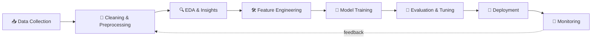

<!-- ============================================================
     IshitaJain-code • AI / ML Engineer • Data Scientist
     Fonts: "Press Start 2P" (pixel headings) + "JetBrains Mono" (body)
     ============================================================ -->

<div align="center">


<a href="https://github.com/IshitaJain-code">
  
</a>

<br/>



<br/><br/>


<br/><br/>


</div>

<br/>


```python
class IshitaJain:
    """Data Analyst turned aspiring ML Engineer & Data Scientist."""

    def __init__(self):
        self.role      = ["Data Scientist", "ML Engineer", "Data Analyst"]
        self.languages = ["Python", "SQL"]
        self.fuel      = ["curiosity", "coffee", "clean datasets"]
        self.mindset   = "If it can be measured, it can be modeled."

    def current_focus(self):
        return {
            "learning":   ["Deep Learning", "NLP & LLMs", "MLOps"],
            "building":   ["End-to-end ML projects", "Streamlit apps for models"],
            "exploring":  ["Generative AI", "Model deployment", "Feature engineering"],
        }

    def goal(self):
        return "Build ML systems that move from notebook to production, and create real impact."

    def ask_me_about(self):
        return ["Data cleaning", "EDA", "SQL", "Dashboards (Power BI / Tableau)", "ML basics"]

me = IshitaJain()
```

I love finding the story hiding inside a dataset, and I'm now taking that curiosity beyond dashboards into **machine learning, deep learning and AI engineering**. My approach is simple: *learn a concept, build something with it, document it publicly.* This GitHub is my lab notebook of experiments, projects and lessons from every step of the **data → insight → model → deployment** journey.

<br/>


| 🧠 Machine Learning | 🔮 Deep Learning | 💬 NLP & GenAI | ⚙️ MLOps | 📊 Data Analytics |
|:---:|:---:|:---:|:---:|:---:|
| Regression & Classification | Neural Networks (ANN) | Text preprocessing | Git & version control | EDA & storytelling |
| Clustering & PCA | CNNs for images | Sentiment analysis | Model packaging | SQL (PostgreSQL / MySQL) |
| Ensemble methods | RNNs / LSTMs | Transformers & Hugging Face | Docker & APIs | Power BI & Tableau |
| Feature engineering | Transfer learning | LLM apps & RAG | Streamlit / FastAPI deploys | Excel & reporting |
| Model evaluation & tuning | PyTorch & TensorFlow | Prompt engineering | Experiment tracking | A/B testing & stats |

<br/>


**Languages & Core**


**Machine Learning & Deep Learning**


**Data Wrangling & Visualization**


**Databases, Deployment & MLOps**


<br/>


How I approach every ML project:



<br/>


> 🔧 **Edit me:** replace `REPO_NAME_1`, `REPO_NAME_2`... with your real repository names and the cards will auto-fill.

<div align="center">

<a href="https://github.com/IshitaJain-code/REPO_NAME_1">
  
</a>
<a href="https://github.com/IshitaJain-code/REPO_NAME_2">
  
</a>
<a href="https://github.com/IshitaJain-code/REPO_NAME_3">
  
</a>
<a href="https://github.com/IshitaJain-code/REPO_NAME_4">
  
</a>

</div>

**Project ideas on my build list**

| Project | Domain | Stack | Status |
|---|---|---|---|
| 🏠 House Price Predictor | Regression | Python • scikit-learn • Streamlit | 🔨 Planned |
| 💳 Fraud / Churn Classifier | Classification | Pandas • XGBoost • SHAP | 🔨 Planned |
| 🎬 Movie Recommender System | Recommenders | Python • Cosine similarity • Streamlit | 🔨 Planned |
| 🖼 Image Classifier | Computer Vision | TensorFlow / PyTorch • CNN | 🔨 Planned |
| 💬 Sentiment Analyzer | NLP | Hugging Face • Transformers | 🔨 Planned |
| 🤖 RAG Chatbot over my notes | GenAI | LLM API • Vector DB • FastAPI | 🔨 Planned |

<br/>


- [x] Python for data analysis (Pandas, NumPy)
- [x] SQL (PostgreSQL, MySQL)
- [x] Data visualization & BI (Power BI, Tableau, Excel)
- [ ] Statistics & probability for ML
- [ ] Supervised & unsupervised learning (scikit-learn)
- [ ] Deep learning with TensorFlow / PyTorch
- [ ] NLP, Transformers & LLM applications
- [ ] MLOps: Docker, FastAPI, CI/CD, experiment tracking
- [ ] Cloud for ML (AWS / GCP / Azure)
- [ ] Kaggle competitions & open-source contributions

<br/>


<div align="center">


<br/>


<br/><br/>


<br/>

<!-- Snake animation: needs the workflow in .github/workflows/snake.yml (run it once) -->
<picture>
  <source media="(prefers-color-scheme: dark)" srcset="https://raw.githubusercontent.com/IshitaJain-code/IshitaJain-code/output/github-contribution-grid-snake-dark.svg">
  
</picture>

</div>

<br/>


Open to collaborations on **ML projects, Kaggle teams, data science study groups and open-source work**. Say hi!

<p align="center">
<a href="https://linkedin.com/in/ishita-jain-5a178a3b0?">

</a>
<a href="https://www.kaggle.com/ishitajain019">

</a>
<a href="https://github.com/IshitaJain-code">

</a>
</p>

<div align="center">


</div>


